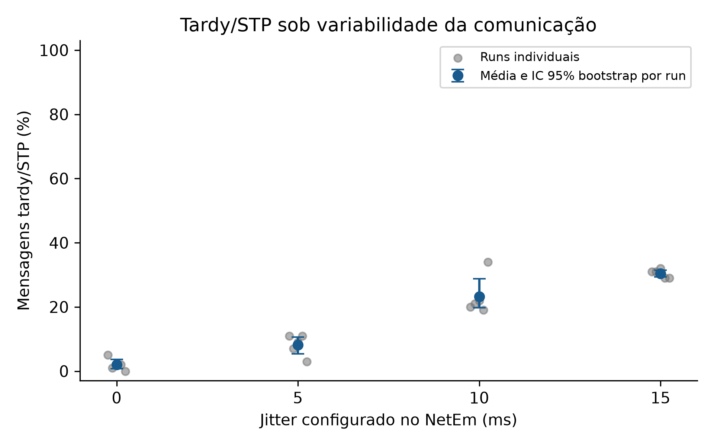

# Experimento V0 de variabilidade de rede com micro-LF

Executado em 21/10/2026, Ubuntu/WSL2. Campanha `v0_20261021T140846_final`.
Estado: 20/20 runs C0–C3 válidos; dois baselines de infraestrutura válidos.
Dados, estatísticas e gráficos foram reconstruídos dos logs; ver
`logs/final_audit.json` e `logs/artifact_manifest.sha256`.

## 1. Objetivo

Investigar como variabilidade induzida exclusivamente na infraestrutura de
rede afeta a ocorrência de mensagens tardy/STP em uma federação micro-LF.

## 2. Pergunta experimental

Como diferentes níveis do parâmetro de jitter NetEm influenciam a taxa tardy
com maxwait fixo e demais condições controladas?

## 3. Hipótese exploratória

Com maxwait e atraso-base de referência mantidos fixos, alterações na
variabilidade temporal da comunicação podem modificar a probabilidade de
mensagens tardy/STP. Monotonicidade não foi pressuposta.

## 4. Arquitetura

Dois federados reais, `JitterV0_sender` e `JitterV0_receiver`, em processos
distintos, comunicam-se por TCP IPv4 em 127.0.0.1:15042. O programa usa backend
native. NetEm atua na raiz de `lo` durante cada run e é removido ao terminar.
Não há sleep, delay, espera ativa nem espera deliberada nas reações.

## 5. Software e preservação do ambiente

Ubuntu 26.04 LTS, kernel 6.6.87.2-microsoft-standard-WSL2 x86_64;
GCC 15.2.0, CMake 4.2.3, Git 2.53.0, OpenJDK 17.0.19,
iproute2/tc 6.19.0 e Python 3.14.4. Análise: NumPy 2.5.4, pandas 3.0.6 e
Matplotlib 3.11.2, instalados em venv isolada. Dependências transitivas estão
em `logs/python_freeze.txt`.

Compilador micro-LF `lfc 0.8.3-SNAPSHOT`, incluído no reactor-uc commit
`e2d9a9fa79620f4f9152ebff2350884e5b5bcb0a`;
nanopb `736ac3a06aa2c192205e65e380eaefb369b4133b`. O `lfc 0.12.1`
preexistente não foi usado. Native não exige template adicional: o template
POSIX foi consultado, mas não foi necessário clonar ou adaptar seus arquivos.

O workspace era vazio e não era um repositório Git; não havia commit/branch
anterior a preservar. O código do runtime e o submodule nanopb permaneceram
sem alterações. A instalação fica em `~/.local/share/microlf-jitter-v0/`.

## 6. Configuração micro-LF

Período 50 ms; maxwait explícito 20 ms no Receiver; 10 eventos de warm-up
(seq 0–9) e 100 eventos medidos (seq 10–109). O Sender deixa de escrever no
output após seq 109. Timeout lógico de 7500 ms dá 2050 ms entre a última
emissão prevista (5450 ms) e o encerramento, cobrindo a graça de 2 segundos.

Startup e input têm reações separadas. O handler `tardy` registra e conta
somente inputs remotos tardios. O timer local do Receiver, também de 50 ms,
garante avanço lógico independentemente da chegada da mensagem; não conta
como mensagem e é idêntico em todas as condições. Esse timer determina a
grade temporal desta implementação e deve ser considerado ao generalizar.

A conexão usa `@buffer(110)`, capacidade para todo o run, em todos os cenários.
No primeiro probe de implementação, o buffer padrão 1 produziu descartes:
31 eventos medidos chegaram, 69 faltaram; o run foi marcado INVALID e preservado
fora da campanha científica. A anotação suportada foi inspecionada no
compilador oficial e corrigida antes do piloto. O baseline foi repetido por
causa dessa mudança de binário e passou. O probe corrigido recebeu 100/100,
com 100 tardy, sem duplicatas. Nenhum código vendor foi alterado.

Tags vêm de `env->scheduler->current_tag`; a função declarada `lf_tag`
não estava implementada/linkável nesta versão. Intended tag vem de
`in->super.intended_tag`. `logs/api_evidence.txt` registra a API e o C gerado
com maxwait MSEC(20), capacidade 110. Clock sync está desligado; um
`LF_CLOCK_EPOCH_NS` comum aos processos evita zeros físicos diferentes no
runtime POSIX, conforme sua implementação oficial.

## 7. Rede

O kernel tem `CONFIG_NET_SCH_NETEM=m`. Após autenticação sudo em terminal
visível, foram comprovadas aplicação de 10 ms e remoção imediata do qdisc:
`logs/netem_probe.json` e log de ambiente correspondente. O tc local aceita
`distribution normal` e `seed`. Cada run salva comando, qdisc efetivo em
texto/JSON, contadores e prova de limpeza. Scripts usam traps EXIT/INT/TERM;
SIGKILL ou falha da máquina não permitem garantir limpeza por trap.

## 8. Variáveis e métricas

Fator: jitter configurado NetEm (0, 5, 10, 15 ms), sem interpretação ±.
Controles: atraso-base configurado 10 ms, maxwait 20 ms, período 50 ms,
quantidade de eventos, buffer, timer e instrumentação. Métrica primária:
`100 × tardy / 100`, exclusivamente em runs válidos, sem substituir o
denominador pela quantidade recebida. Warm-up é excluído por seq.

Timestamps CLOCK_MONOTONIC do mesmo sistema são unidos por seq.
`one_way_delay_ms` mede **envio na reação → execução da reação de entrada**,
incluindo fila, TCP, runtime, STP e agendamento. Não mede isoladamente latência
do fio ou instante de chegada ao socket. `delay_std_ms` é desvio-padrão
descritivo desse atraso, não um sinônimo de jitter. IPDV é definido aqui como
`abs(delay_i - delay_(i-1))`, em ordem de seq, e reportado separadamente.

## 9. Cenários

| Cenário | Atraso-base configurado | Jitter configurado | Distribuição |
| --- | ---: | ---: | --- |
| B0 | Sem NetEm | Não aplicável | Não aplicável |
| C0 | 10 ms | 0 ms | Sem variação |
| C1 | 10 ms | 5 ms | normal |
| C2 | 10 ms | 10 ms | normal |
| C3 | 10 ms | 15 ms | normal |

C0 usa efetivamente `netem delay 10ms seed ...`. C1–C3 usam
`netem delay 10ms <jitter>ms distribution normal seed ...`.
O atraso-base **configurado** permanece 10 ms. A média do atraso **observado**
não é garantida constante: truncamento de atrasos negativos no modelo,
TCP, filas e execução também influenciam as observações.

## 10. Piloto e replicações

Piloto separado: uma repetição por cenário. Critério definido antes da coleta:
todos ≤1% ou todos ≥99% indicariam falta de sensibilidade e impediriam a
campanha automática. O piloto foi informativo, sem calibração; consultar
[PILOT_REPORT.md](PILOT_REPORT.md). Configuração, fonte e binários foram
congelados em `config/frozen.json` antes da campanha final.

Cinco blocos finais, com C0–C3 em ordem aleatorizada em cada bloco; seed
mestre 20261020. Ordem e seeds distintas por run:
`results/raw/final/v0_20261021T140846_final/order.csv`. B0 foi coletado antes e depois.
O baseline e o probe de implementação não entram nas estatísticas finais.

## 11. Validade e verificações

Cada run final tem exatamente 100 envios medidos, 100 recebimentos medidos,
todos os seq esperados uma vez, normal+tardy=100, missing=duplicates=0,
summaries coerentes e processos encerrados com status 0. O analisador também
verifica qdisc, atraso, jitter, seed, limpeza e coerência entre tipo do handler,
tag lógica e intended tag. Runs inválidos têm taxa em branco e continuam em
`all_runs.csv`; o probe inválido inicial foi preservado.

Seis testes do analisador cobrem warm-up, perdas, duplicata substituindo uma
ausência, falha de processo, limpeza da rede e bootstrap determinístico com
exclusão de run inválido. Usam cópias temporárias e não geram dados científicos.

## 12. Resultados

20/20 runs do fator jitter válidos. B0: rep 0: 100 normal, 0 tardy; rep 6: 100 normal, 0 tardy.
Taxas individuais (%), por repetição:

| Cenário | Rep 1 | Rep 2 | Rep 3 | Rep 4 | Rep 5 |
| --- | ---: | ---: | ---: | ---: | ---: |
| C0 | 5 | 1 | 2 | 2 | 0 |
| C1 | 11 | 7 | 9 | 11 | 3 |
| C2 | 20 | 21 | 22 | 19 | 34 |
| C3 | 31 | 31 | 32 | 29 | 29 |

## 13. Estatísticas entre runs

| Cenário | n | Média % | Mediana % | DP entre runs | Mín % | Máx % | IC95 baixo % | IC95 alto % |
| --- | ---: | ---: | ---: | ---: | ---: | ---: | ---: | ---: |
| C0 | 5 | 2.00 | 2.00 | 1.87 | 0.00 | 5.00 | 0.80 | 3.60 |
| C1 | 5 | 8.20 | 9.00 | 3.35 | 3.00 | 11.00 | 5.40 | 10.60 |
| C2 | 5 | 23.20 | 21.00 | 6.14 | 19.00 | 34.00 | 19.80 | 28.80 |
| C3 | 5 | 30.40 | 31.00 | 1.34 | 29.00 | 32.00 | 29.40 | 31.40 |

IC percentile bootstrap da média com 10.000 reamostragens dos valores por
**run**, seed 20261020. Não houve reamostragem de mensagens individuais nem
teste de hipótese sofisticado. DP entre runs usa estimativa amostral (n−1).

Os intervalos de confiança desta etapa são exploratórios; o número de
replicações da dissertação será posteriormente definido a partir da
variabilidade observada e da precisão estatística requerida.

Medidas secundárias em ms: cada célula abaixo é a média das respectivas
estatísticas calculadas individualmente nos cinco runs; não é percentil da
mistura de todos os runs.

| Cenário | Atraso médio | DP do atraso | P50 | P95 | P99 | IPDV médio |
| --- | ---: | ---: | ---: | ---: | ---: | ---: |
| C0 | 14.21 | 6.93 | 13.15 | 14.43 | 49.72 | 1.72 |
| C1 | 14.23 | 6.60 | 13.80 | 23.94 | 36.90 | 6.18 |
| C2 | 14.29 | 9.29 | 13.25 | 31.00 | 35.70 | 10.52 |
| C3 | 16.82 | 13.95 | 13.25 | 41.33 | 54.09 | 14.07 |

## 14. Figuras

[Versão PDF](results/figures/tardy_rate_vs_jitter.pdf).
Pontos individuais e IC bootstrap por run; B0 está excluído do gráfico.
Figuras adicionais: `delay_distribution_by_scenario.png` e
`p95_delay_vs_jitter.png`. A distribuição secundária reúne mensagens medidas
dos runs válidos e é somente descritiva, sem IC por mensagem.

## 15. Interpretação

As médias observadas cresceram nesta campanha conforme o parâmetro de jitter aumentou. Essa observação vale para o ponto operacional V0 e não
estabelece que mais jitter sempre cause mais tardy em qualquer sistema.
O efeito observado combina a configuração de NetEm com TCP, timer do Receiver,
runtime, tráfego de controle e escalonamento do host. Não permite isolar um
efeito de variância mantendo a média física observada invariável.

## 16. Limitações

Uma única máquina WSL2, execução em loopback e apenas cinco replicações por
cenário. Logs e instrumentação têm custo; o runtime manteve seu logging
normal, igual em todas as condições. O relógio físico interno do runtime
POSIX se baseia em CLOCK_REALTIME com época compartilhada; a métrica de atraso
usa CLOCK_MONOTONIC. Não foi monitorada disciplina de relógio/NTP ou carga
externa do host durante toda a campanha. Seeds reconstituem o plano e a
configuração estocástica, mas não garantem igualdade bit a bit dos resultados
de execução sob agendamento e tráfego concorrentes.

## 17. Ameaças à validade

- Sender e Receiver estão na mesma máquina e usam loopback.
- NetEm em lo afeta ACKs e tráfego de controle além da mensagem de aplicação.
- TCP pode introduzir ordenação e bloqueio head-of-line; atrasos podem gerar rajadas.
- O sistema operacional/WSL não é hard real-time.
- Há poucas replicações e somente um host/uma campanha final.
- A distribuição NetEm é um modelo artificial e pode sofrer truncamento.
- Resultados V0 não generalizam diretamente para uma rede industrial real.
- Tardy/STP não equivale a deadline miss; maxwait não é deadline.
- Valores configurados NetEm não são sinônimos dos valores observados.
- Atraso envio→reação inclui processamento, não somente transporte.
- A próxima campanha deve usar duas máquinas físicas e estudar sincronização
  de relógios, carga, precisão e quantidade de replicações.

## 18. Reprodutibilidade e próximos passos

Seguir os comandos de [README.md](README.md). `results.csv` deriva dos logs;
`summary.csv`/`summary.json` e gráficos derivam da mesma reconstrução.
`all_runs.csv` inclui todas as fases; `events.csv` inclui o vínculo por seq e
os timestamps. A auditoria independente reconstitui CSV e bootstrap, confere
as cinco replicações por cenário, plano, hashes e limpeza final da rede.

Fonte SHA256: `2dd20441bcfdef8a49a38beba4a126b55be71e101743e8ded12f86c65c87956e`.
Configuração SHA256: `d57f6bab91cb0c90eacbd597045f7dfd016213f02c252b139803270500db0c0a`.
Preservar os arquivos brutos e o manifesto antes de ampliar a campanha.
Na dissertação, definir o número de replicações pela precisão desejada,
separar caminhos de dados/controle e usar dois hosts com relógios avaliados.

Fontes primárias consultadas: [micro-LF](https://micro-lf.org/),
[runtime no commit fixado](https://github.com/lf-lang/reactor-uc/tree/e2d9a9fa79620f4f9152ebff2350884e5b5bcb0a),
[template POSIX](https://github.com/lf-lang/ulf-posix-template) e
[tutorial indicado](https://perkusic.github.io/lingua-franca-docs/tutorial/lingua_franca_tutorial.html#s2).
O navegador falhou para o tutorial, mas o HTML foi posteriormente obtido por
curl e preservado em `logs/tutorial.html`. A implementação foi guiada pelos
exemplos e APIs locais do commit efetivamente utilizado.
